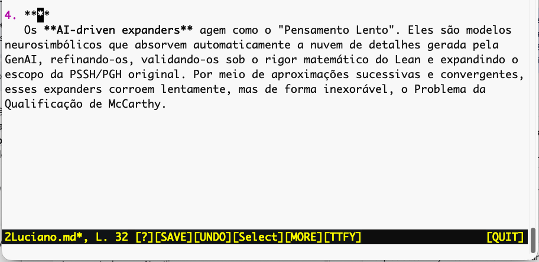
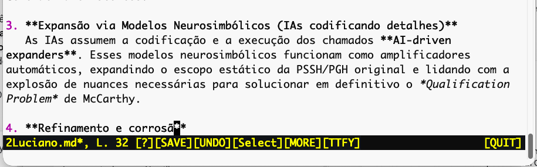
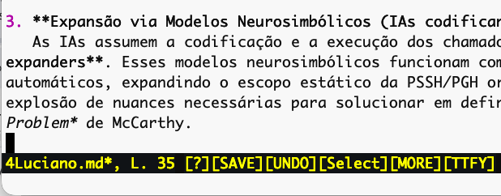
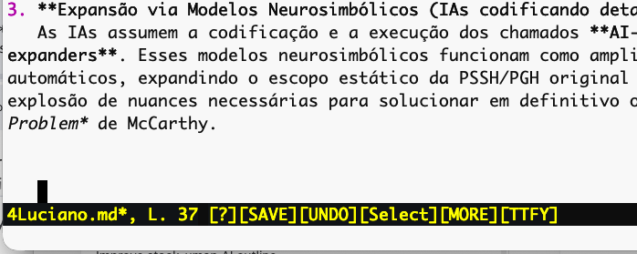
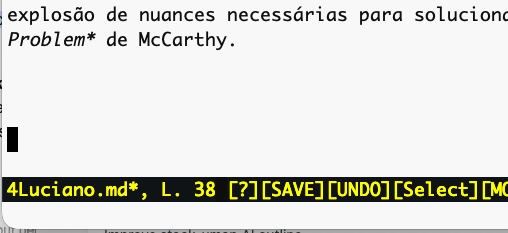

# November -- 2026

## November 07, 2026. Complaint 1

I copied about fifty lines from the Internet and inserted them into a buffer with C-y. I edited the copy. Then I inserted more lines from the clipboard with C-y. The second insertion was very slow (one line per second).  The second copy has a list of four items. Two false entries were added to the list (not registered in the figures below).




Screenshot 1 shows the cursor at the beginning of an edit. After I type a few characters, the window scrolls and the cursor jumps to the last line. I repeated the experiment many times. I didn't close the window because you may have trouble reproducing the bug. In that case, you can try reproducing it in my open file.

### Investigation and repair

We separated two symptoms: a cursor jump while typing and a slow paste that
changed list numbering. Turning word wrap off did not stop the jump. The saved
file reproduced it in another terminal, without another clipboard operation.
It also reproduced in the GUI. The decisive input was `ã`; ordinary letters
were not the trigger.

Two UTF-8 defects were found. Unwrapped navigation could put point between the
two bytes of `ã`. Also, keyboard input inserted its bytes in separate editor
turns. Redisplay could therefore see an unfinished character and reframe the
window, moving the visible cursor toward the bottom. This was an input and
cursor-boundary problem; we found no evidence of a garbage-collector failure.

`src/display.c` now keeps unwrapped movement and mouse placement on character
boundaries. `src/key.c` collects a complete UTF-8 character before returning
it. `src/command.c` inserts or overwrites that character before redisplay.
Malformed input gives unrelated lookahead back to the key reader. A continuation
byte cannot become the editor's synthetic resize key.

Evidence: Eduardo confirmed that typing `ã` in a freshly launched GUI no longer
moved the window. `tests/unwrapped-navigation.c` checks 240 navigation cases.
`tests/utf8-input.c` checks complete-character insertion, overwrite and lookahead.
`tests/utf8-typing.sh` types `ã` through a real pseudo-terminal and checks both
saved bytes and the centred viewport. The fixes were committed as `c305b53` on
7 November 2026.

After the cursor repair, Eduardo could no longer reproduce the original C-y
slowdown. His working explanation is that it was a consequence of the cursor
error. We close that complaint on this basis and do not pursue it further.
Complaint 3 concerns the separate terminal ⌘-V path.

## November 07, 2026. Complaint 2
Cursor is jumping. Screenshot 1 -- Cursor at the end of the buffer. Screenshot 2 -- I press Enter two or more times to introduce a few blank lines; the cursor shouldn't move down, but it advances a few columns. Screenshot 3 -- I click the up arrow or click the line above the displaced cursor; it goes to column 1, where it should have been all along.





### Investigation and repair

The apparent horizontal drift was real indentation in the buffer. Markdown's
Return handler inherited indentation from the preceding list paragraph and
inserted spaces on blank prose lines. Repeated Return therefore left the cursor
a few columns to the right.

Both Markdown implementations now leave a blank prose line unindented:
`compiled/scripts/markdown.scm` and `scheme/languages/markdown.scm`. Return still continues a nonempty list item, ends an empty item, and preserves the existing fenced-code rule. This repair is also in commit `c305b53`.

`tests/markdown-blank-newline.sh` checks those five cases through real terminal
keys with each Scheme runtime: ten passing cases. It compares saved text,
including spaces, rather than relying on cursor appearance alone.

## November 07, 2026. Complaint 3
If I copy text from the internet and paste it with Command ⌘-v, it is very slow, and the inserted text may contain one or two errors. It would be nice if Command-C and Command-V worked normally. 

### Cause and repair

In a text terminal, ⌘-V belongs to the terminal application. Without paste
framing, Chezweb receives a stream indistinguishable from typing. It processes
and redraws each character, and each pasted Return can run Markdown's automatic
list continuation. That explains a concrete route to slow paste and unwanted
numbered items. C-y uses a different clipboard/yank path.

Chezweb now enables bracketed paste when entering the terminal and disables it
on exit. `src/key.c` recognises the opening marker. `paste_bracketed` in
`src/command.c` collects the payload through the closing marker, normalises CR
and CRLF line endings to LF, and inserts it as one undoable edit. Pasted control
bytes remain text; they do not run commands. Markdown's Return handler is not
called. Read-only buffers reject the insertion after consuming the whole frame,
so rejected text cannot leak into subsequent commands.

The temporary collection is limited to 16 MiB. If collection exceeds that limit
or allocation fails, the rest of the frame is consumed and nothing is inserted.
An incomplete frame also inserts nothing. Overwrite mode retains the existing
yank policy of refusing insertion. The kill ring is not replaced by this path.

Protocol reference: [XTerm control sequences, bracketed paste mode 2004](https://invisible-island.net/xterm/ctlseqs/ctlseqs.html).
The terminal must support and honour this protocol. Its own configured paste
throttling can still limit transfer speed; Chezweb avoids running editor commands
for each pasted character.

⌘-C remains the terminal's native copy command. In Chezweb's GUI, ⌘-C and ⌘-V
already have explicit copy/paste handlers. There is no need to disable Command.
In a terminal, use its native selection for ⌘-C, or Chezweb's marked-region copy
command M-w.

Regression test: `tests/bracketed-paste.sh` exercises a multiline Portuguese
Markdown paste, one-step undo and read-only rejection with both Scheme runtimes.
It compares saved bytes with the expected text; all six cases passed.
`tests/bracketed-paste.c` also passed decoder checks for CR/CRLF, literal
control bytes (including NUL), a partial closing-marker prefix, an empty frame,
an incomplete frame, size-limit rejection, read-only and overwrite rejection.
The size test uses a 32-byte limit to exercise rejection without large allocation.
This repair is local and has not
yet been committed or pushed.

### Build and publication issues found the same day

The first Windows regression build failed when linking the new small C test
harnesses under Cygwin. The production installer had built; the harnesses needed
Cygwin-specific whole-program optimisation and restricted symbol exports.
Commit `71c5109` fixes the common makefile; Windows commit `f51a771` passed native
build, regression checks, clean installation and terminal/GUI startup:
[successful Windows run](https://github.com/FemtoEmacs/Femto-Emacs/actions/runs/42402883083).

A macOS Apple Silicon runner timed out during the long navigation test. The
test now waits for a checked line-number acknowledgement every 200 keys rather
than accumulating unchecked terminal input. Commit `d585b0e` also increases the
per-traversal timeout and bounds failure output. The complete navigation test,
including repeated traversals, passed locally.

Windows originally ran only in its separate workflow. Commit `05ac65e` adds an
explicit Windows installer job to the main `build.yml`, calling the Windows
branch's reusable workflow. This keeps the native Windows port intact.

The successful build had uploaded Actions artifacts but had not published a
new Release. We published the [7 November Windows preview](https://github.com/FemtoEmacs/Femto-Emacs/releases/tag/chezweb-windows-0.1-2026-11-07)
from the verified `f51a771` revision, with installer, matching component sources,
package list and checksums. The installer SHA-256 was checked against the build's
manifest. The later integrated CI run is separate evidence; publication does
not imply that every subsequent run has finished.


### Validation of the local clipboard repair

`make` and the maintainer browser rebuild completed. `make check` passed,
including the four cumulative wrapped-file traversals with Vim/READ switches.
The separate paste-decoder target passed. `make check-selfhost` passed with a
byte-identical compiler rebuild. UI checks passed; the PDF fixture test was
skipped because `ttfy/benedetto.pdf` is absent. These are automated tests through a pseudo-terminal; the new ⌘-V path still deserves Eduardo's check in a fresh Terminal or iTerm session with his usual clipboard text.

## November 08, 2026. Claude's eval of Nov 07 bugs found a chink.
The logbook describes three complaints, two repairs committed as `c305b53` and one uncommitted. To judge them I need the code and its history, not just the narrative:The fix is good: the diagnosis is right and the repair is at the source. There's one gap I'd close and one conclusion I'd revise.

**The cursor jump (Complaint 1): diagnosis confirmed.** Your second screenshot ("corrosã", the cursor thrown to the last line) matches what the code does before the fix:

1. The main loop (`src/main.c`) redraws the screen before every key, and `get_key` handed over the two bytes of `ã` as two separate keys. So the editor redrew between them, with only the first byte in the buffer.
2. The painter (`update_display`, `src/display.c`) advances character by character. Reading that lone first byte, it assumed a two-byte character, jumped over the cursor's position, and never found the cursor on the page.
3. When the cursor isn't found, the editor reframes the window so the cursor sits on the bottom line. That's the jump you saw.

Codex's repair, `get_key` delivering a complete character and `insert()` inserting it whole, removes exactly this cause. The second defect it found is also real: the up/down arithmetic counted bytes as columns, so it too could leave the cursor inside `ã`. I read the diff of `c305b53` and found no error in it.

**The gap: the painter is still fragile.** Codex fixed the two known ways of putting the cursor inside a character. But the painter still reacts to any such position by reframing the window. A script that computes positions with `string-length`, which counts characters while the buffer counts bytes, would bring the jump back. A three-line guard would make it impossible for good: when the cursor falls inside a character, draw it on that character. Separately, every character still counts as one column, so combining accents and wide characters (CJK, emoji) can shift the cursor. That matters for polytonic Greek if your keyboard produces combining accents.

-- Claude, insert the three-line guard that would make the jump impossible for good. Introduce a polytonic Greek keyboard, since it would be very usefull.

**The C-y slowdown: I'd revise that conclusion.** Complaint 1 was closed because "it no longer reproduces". But C-y (`yank-command`) inserts the whole text in one step. It can't be slow line by line, and it can't run Markdown's Return handler, which is what adds false list items. Both symptoms are exactly what Complaint 3 explains: the terminal's ⌘-V arrives as if typed. So the first paste was most likely ⌘-V, and the real fix is the bracketed paste. If you remember using C-y there, it deserves a reproduction.
-- Human comment: I agree.

**The blank Markdown lines (Complaint 2): correct.** The indentation really was in the file, the change is the same in both Markdown implementations, and the test compares the saved bytes, spaces included.

**⌘-V (Complaint 3): right approach, still uncommitted.** Bracketed paste (mode 2004) is the standard solution and is well implemented: it consumes the whole frame even on failure, normalizes CR/CRLF, makes one undoable edit, and covers the 16 MiB limit. Small loose ends:
- The mode is turned off only on a normal exit. A crash or kill leaves it on in your shell.
- Programs run with M-! inherit it while they run.
- It's still local: commit it once you've tested ⌘-V in a fresh Terminal.

I only read the code and the screenshots and didn't build chezmoi here. Shall I write the display guard, with a test that puts the cursor inside `ã` and checks the window doesn't move?


## November 08, 2026. Complaint 1.
I use the mouse wheel to scroll past the text, so the screen goes blank. Then, I click on the blank screen. The window scrolls automatically until the first non-blank line, which appears at the end of the screen. At this point, the scroll wheel stops responding to up commands, but responds to down commands. After down-wheeling the mouse, up-wheeling starts responding as well.

* ~/mysand/chezmoi/bug_events/nov2026-figs/nov-08-2026-Complain1-fig01.png
* ~/mysand/chezmoi/bug_events/nov2026-figs/nov-08-2026-Complain1-fig02.png

This is not Emacs behavior. In Emacs, in a terminal, the blank window doesn't scroll when I click on it.


## November 08, 2026. The guard and the backdoor (Claude)

### The guard

The display (`update_display`, `src/display.c`) finds the cursor by
walking the page a character at a time. When point lay inside a
multi-byte character, the walk stepped over it, the cursor was "not
found", and the window reframed with the cursor on its last row: the jump
of 7 November. Codex's repair removed the two known causes (keys delivered
byte by byte, and up/down arithmetic in bytes); the display stayed fragile
to any other one. Now, when point falls inside a character, the display
moves point to the start of that character and draws the cursor there.
The window does not move, and typing there cannot split the character.

### The backdoor

M-x backdoor-claude or M-x backdoor-codex opens it; the same command closes
it. While open, the mode line shows B/D and the editor records one line per
key (`#N KEY pt= page= cur=ROW,COL size= BUFFER`) and one-line notes:
`guard: point P was inside the character at C` and `reframe: point P not on
the page` from the display, `note: TEXT` from scripts (`fe-backdoor-note`).
The lines appear in the buffer *backdoor* (refreshed only while a window
shows it) and in `~/.chezemax/backdoor.txt` (written at most once a second
and on closing), which an assistant reads. Only the last 120 lines are kept
(15 KB at most). Closed, the backdoor frees its memory and its buffer; what
remains is one test of an int per key. Code: `src/backdoor.c`; how to use it
for a diagnosis: `AGENTS.md`, "The backdoor".

### Evidence

`tests/backdoor-guard.sh` (in `make check`) opens the backdoor in a PTY,
centres a line containing "coração" (line 50 of 60), and has a script put
point inside `ç`. With the guard: a `guard:` note, page 333 before and
after, cursor row 11. With the guard disabled, the same keys give a
`reframe:` note and the window moves from page 333 to 243, the line from
row 11 to row 21, the bottom: the jump, reproduced. The test also checks
B/D, the file left on closing, and the 120-line cap after 300 keys.
`make`, `make check`, `make check-ui` and `make check-selfhost` pass on
Linux. The browser bundle must be rebuilt (`make browser-rebuild`).

### Found with the backdoor: incremental search splits characters

The backdoor's first run showed the guard firing during C-s: typing `aç`
in the search prompt put point between the two bytes of `ç` before the
second byte arrived. The search prompt reads keys a byte at a time, the
defect Codex fixed in `get_key`. The guard now hides it from the display;
the search itself should read whole characters. Not yet repaired.

### Still open

- Every character counts as one column: combining accents (zero width)
  and wide characters (CJK, emoji: two cells) can misplace the cursor.
  Relevant to polytonic Greek typed with combining accents.
- A polytonic Greek keyboard (requested above).
- November 08, Complaint 1 (clicking a blank window scrolls it).

## November 08, 2026. Character widths (Claude)

The first item still open above. Every character counted as one column:
a combining accent (polytonic Greek typed as letter + accent, U+0300-036F)
moved everything after it one column to the right of where the terminal drew
it, and a wide character (CJK, emoji) one column to the left.

`src/width.c` now gives each character its columns: 0 for combining accents
and invisible format characters, 2 for East Asian wide and fullwidth
characters and emoji, 1 for the rest (precomposed Greek, U+1F00-1FFF,
included). One table serves everything:

- the C core (`src/display.c`): the painter, up and down movement (a goal
  column inside a wide character lands after it, as Emacs's
  `move-to-column`), the column of a mouse click, and C-e on long lines.
  A wide character that would cross the right edge starts the next row, as
  terminals draw it. After reaching a column, the cursor goes past the
  accents of the character before, never between a letter and its accent;
- Markdown/TeX/text word wrap (`markdown-wrap-end`, both runtimes), through
  a new script function `(fe-char-width code-point)`, called only for
  non-ASCII characters;
- the SDL window (`src/gui.c`) and the browser (`web/screen.c`,
  `web/page.js`): a cell keeps its character and up to two accents, drawn
  together; a wide character takes a second cell; backgrounds are painted
  before glyphs so a wide glyph is not covered.

The terminal draws accents and wide characters itself (ncurses).

Evidence: `tests/char-width.sh` (in `make check`) reads the cursor columns
from the backdoor in a PTY: decomposed accents, CJK, and a CJK character at
column 79 of 80. `tests/scripts-cases.scm` compares the wrap with accents
and CJK, and the widths, in both runtimes. `tests/chezweb-width.cjs` (in
`make check-browser`) checks the browser's screen text and cursor columns
for decomposed `ἐν ἀρχῇ`, `ação` and `中文x`. A screenshot of the SDL window
(Xvfb) showed the Greek accents on their letters. CJK appeared as empty boxes
there: the window uses one monospaced font and SDL_ttf has no fallback, a
font matter, not a width one.

Found and fixed on the way: the backdoor did not write its file when
`~/.chezemax` did not exist yet (the browser, a new account); it now makes
the folder.

`tests/unwrapped-navigation.c` (7 November) assumed that the emoji U+1F642
takes one column; it takes two, as terminals draw it. Three of its
expectations changed accordingly (column 4 lands after the emoji; the full
row 🙂B on a 3-column screen ends before the newline; a click on column 1
lands on the emoji). Both its checks pass.

## November 08, 2026. The polytonic Greek keyboard (Claude)

M-x polytonic turns on a keyboard for polytonic Greek in Beta Code (the
TLG's convention); the same command turns it off. The mode line shows Ἑλ.

- Letters: a α, b β, g γ, d δ, e ε, z ζ, h η, q θ, i ι, k κ, l λ, m μ,
  n ν, c ξ, o ο, p π, r ρ, s σ, t τ, u υ, f φ, x χ, y ψ, w ω, v ϝ, j ς.
- Marks, typed after the letter: `)` smooth, `(` rough breathing, `/`
  acute, `\` grave, `=` circumflex, `|` iota subscript, `+` diaeresis:
  `a)/` ἄ, `w(=|` ᾧ, `i+/` ΐ, `r(` ῥ. A new accent replaces the old one.
- Capitals: `*` and the marks before the letter, as in Beta Code (`*)/a`
  Ἄ), or Shift.
- σ becomes ς when the word ends (blank, punctuation, RET).
- `:` ano teleia (·), `'` apostrophe of elision (’), `#` keraia (ʹ).
- Marks apply to vowels (all) and rho (breathings); after another letter
  or a blank, or typed twice, a mark is the character itself, so `(λόγος)`
  is typed `(lo/gos)`.
- The result is precomposed (NFC), from a table generated from Unicode's
  own decompositions (211 characters). A combination with no precomposed
  character (ε with circumflex) gets a combining accent, which the display
  now draws on its letter.

Code: `compiled/scripts/polytonic.scm` (a self-insert hook; no C). It runs
in the terminal, the SDL window and the browser. Tests: `tests/polytonic.sh`
(in `make check`) types two lines of Beta Code (John 1:1 and the first line
of the Odyssey, with ῥήτωρ, ΐ, parentheses, a doubled mark and ε͂) and
compares the saved bytes; `tests/chezweb-polytonic.cjs` (in `make
check-browser`) types John 1:1 in Chrome.

## November 08, 2026. Complaint 1 (the ghost window): investigation and repair (Claude)

Reproduced with the backdoor in a PTY: 20 wheel notches down a 50-line file
leave its last line at the top of the window (page 383); a click on the
blank rows below puts point at the end of the text (391), and the window
jumped to page 223 with the cursor on its last row. Wheel notches up then
dragged the cursor along.

The cause: `update_display` (`src/display.c`) reframes when
`b_epage <= b_point`, `b_epage` being where the last paint stopped. When the
text ends inside the window, the paint stops at the end of the text, which
is where the click put point: `<=` read "point is below the window" for a
cursor that was on it. Every later redisplay reframed again for the same
reason, which is why the wheel seemed not to scroll up.

The repair: before reframing, `end_on_page` checks whether point is the end
of the text and that end is on the page (on the last line's row, or on the
row after it when the text ends with a newline). Then the window stays, as
in Emacs. After the repair: the click leaves page 383, the cursor at the
end on row 1; the wheel scrolls up three lines a notch (383, 359, 335,
311), the cursor at the end of the text, visible.

Evidence: `tests/ghost-window.sh` (in `make check`) replays the wheel and
the click, with and without a final newline, and reads page and point from
the backdoor. It fails without the repair ("the click moved the window
(page 383, then 223)") and passes with it.

## November 08, 2026. Chinese input in tonal pinyin (Claude)

M-x chinese-input turns on Chinese typed in tonal pinyin; the same command
turns it off. The mode line shows 中 (anyone typing Chinese has a font for
it; 🀄 depends on emoji support, PY says less).

No burden for anyone else: the code is a small script
(`compiled/scripts/chinese.scm`); its two tables, in the folder `Chinese/`,
are read only when the input is turned on (0.19 s, 150 KB) and dropped
when it is turned off. `tests/chinese-input.sh` checks that the tables do
not exist before M-x chinese-input, nor after it is turned off.

Typing: the letters of a syllable (ü is v) show its candidates, every tone,
most frequent first; a digit 1-5 then picks the tone (5 neutral) and only
its characters remain; then 1-9 takes a candidate (SPC the first, also
before a tone); - and = page; DEL takes back the tone, then letters; RET
inserts the letters as typed; C-g drops them. After a character, its 联想
followers show (中→ 1国 2心 3央 4学 ...): 1-9 takes one, whose own
followers then show. , . ? ! : ; type ，。？！：；. Keys the input does not
use go on to the other key handlers (vim mode keeps working).

The tables (`tools/chinese-tables.sh`, sh/awk/sort, maintainers only):

- `Chinese/pinyin.txt`: the 8105 characters of the 通用规范汉字表 (2013)
  with their readings, from Unihan's kTGHZ2013 field (via
  mozillazg/pinyin-data), ordered by the frequencies of jieba's
  dictionary; 1699 lines (syllables with and without tone).
- `Chinese/lianxiang.txt`: for 5024 characters, at most nine followers,
  from the most frequent two-character words of jieba's dictionary.
  中's first page is 国 心 央 学 间 部 共 原 华: jieba ranks 文 and 午
  below these.
- `Chinese/README.md`: the sources and their licences (Unicode V3, MIT,
  MIT).

In the browser, M-x chinese-input says to use the system's pinyin input
method, which the page's text field takes: the page does not carry the
tables. `make app` copies `Chinese/` into Chezweb.app; the Windows
installer (its own branch) will need the folder too.

Evidence: `tests/chinese-input.sh` (in `make check`) types, in a PTY,
zhong 1 1, 1 (the follower 国), ni3 1, hao3 SPC, a comma, wo SPC, abc RET,
zhonx DEL g 1 2, ma C-g, then turns the input off and types ok; the saved
file is 中国你好，我abc钟ok.


## Claude's explanation of the architecture.

1. **No navegador**, o núcleo C é compilado pelo Emscripten com JSPI. Os scripts são o programa WasmGC que o Schemer compila. O Schemer é um compilador inspirado no Chez, não um clone modificado dele.
2. **C e Scheme conversam por uma caixa de correio** (`bridge.c`/`bridge.scm`), uma memória pequena onde cada lado escreve os argumentos e lê as respostas.
3. **O `%mem-u8` e o `%mem-u8-set!`** são primitivas do Schemer que leem e gravam um byte nessa caixa (`i32.load8_u`/`i32.store8`). Não leem a memória linear do editor nem ponteiros arbitrários do C.
4. **No navegador, a caixa é copiada** do heap do C para a memória do módulo e de volta, a cada chamada (`fromC`/`toC` em `web/runtime.js`). Não é custo zero, mas é barato.
5. **O JSPI suspende essa pilha mista** (C → Scheme → C) quando o editor espera uma tecla ou um arquivo.
6. **O C-c d na janela nativa** grava um retrato do buffer num diretório temporário privado.
7. Em seguida, **inicia o `chezweb-server`**, preso a 127.0.0.1 e protegido por uma chave aleatória, e abre o Chrome nesse endereço.
8. **A página busca o retrato**, as suas configurações e os seus scripts compilados por HTTP.
9. **Na volta, o C-x C-s no navegador envia o texto** por um PUT para `session`. O servidor grava o arquivo `pending`.
10. **Na próxima tecla, o C nativo (`chezweb_poll`) importa esse arquivo** para o buffer, ou para um buffer de conflito, se o original mudou nesse meio-tempo. Arquivos e HTTP, portanto: nenhuma memória compartilhada entre as duas janelas.

## November 09, 2026. Complaint 1.
In the browser, when I press Tab to choose a new folder, ChezWeb asks to allow access to the folder. This is correct. But whenever I press subsequent TABs, it keeps asking for permission instead of completing the folder, the subfolder and the file names.

Also, you recommend using cd --pick to select orgmode (the folder name). I thought the idea interesting, but I don't know how to use it. Can you explain what you had in mind when you proposed cd --pick to select orgmode?

* ~/mysand/chezmoi/bug_events/nov2026-figs/nov-09-2026-Complain1-fig01.png

I also don't know what to do when I get the red message at the top of the window saying: "Not saved: the native buffer changed, was closed, or is read-only." What can I do to save the text before quitting the browser window? Don't you think we should have means of updating the native window from the browser and solve the issue? For instance, with the command M-x native-window-update.

* ~/mysand/chezmoi/bug_events/nov2026-figs/nov-09-2026-Complain1-fig02.png

## November 09, 2026. Complaint 1: report (Claude)

### 1. TAB kept asking for a folder

Cause (`web/files.js`). Chrome tells a page the name of the folder you
choose, never where it is. For `Find file: ~/mysand/chezmoi/or`, TAB asked
for the folder of the path's *first* component, `mysand`, and refused any
other: you chose `chezmoi` (fig 01), it was refused, nothing was granted,
so every later TAB asked again. The refusal was the red line that told you
to use `cd --pick`.

Repair. Any folder that the typed path names now does: for
`~/mysand/chezmoi/or`, `mysand` or `chezmoi`. The folder is mapped where
the path puts it: choosing `chezmoi` makes it `~/mysand/chezmoi/`, so the
next TABs complete `orgmode/`, its subfolders and files without asking. The
request says which folders will do ("Choose the chezmoi or mysand folder");
a folder the path does not name is refused with the same names, and nothing
is granted. `cd` and `ls` in C-c m follow the same rule (`cd ~/work/site`
accepts `work` or `site`).

### 2. What `cd --pick` was for

The refusal offered another way: use the folder you chose under its own
name. In the browser, C-c m opens the command line; type `cd --pick` and
RET. Chrome's folder picker opens; choose, e.g., `orgmode`. It becomes
`~/orgmode/` (named by its own name, since the page cannot know where it
is) and the current directory: C-x C-f then starts there, and TAB completes
in it. `ls --pick` lists a chosen folder without changing directory; the
Choose folder button does what `cd --pick` does. With the repair you no
longer need it for a path you type, but it is the quickest way to reach a
folder whose place in your home does not matter.

### 3. "Not saved: the native buffer changed, was closed, or is read-only"

What happened. After C-c d, the browser's C-x C-s writes the file through
the native window, which first checks that its own buffer is still the one
the browser was given: open, visiting the same file, writable, and with the
text C-c d sent (or the browser's). Otherwise one window would silently
overwrite the other's work, so the save is refused, the browser text stays
in the browser and goes to a `*web-N*` buffer of the native window.

What you could do then: in the native window, C-x b `*web-N*`, C-x C-w
the file's name (or copy the text into the file's buffer and C-x C-s).

What you can do now: your proposal, M-x native-window-update, in the
browser. It puts the browser's text in the native buffer, and C-x C-s
(in either window) then saves.

- The native buffer was edited after C-c d: its text goes to a buffer
  `*native-N*` first (unless it is the text on disk), then the browser's
  replaces it.
- The buffer was closed, or saved under another name (C-x C-w): the
  file is opened again in the native window with the browser's text; a
  file saved under another name is not touched.
- The buffer is read-only: nothing changes; C-x C-q in the native window
  makes it writable (the update or the save then works).
- The update writes no file. If the file changed on disk since C-c d,
  it says so, and the browser still will not overwrite it: C-x C-s in the
  native window decides.

The refusal now says which of these happened, and what to do, e.g.:
"Not saved: the native buffer was edited after C-c d. Your text is kept in
both windows (...). M-x native-window-update puts your text in the native
buffer (its edits go to a *native-* buffer); then C-x C-s saves."

The command travels as the save does: the page sends `PUT update` to
`chezweb-server`, which hands it to the native window (`save.pending`, the
word `update` in place of the revision); the native side answers with the
new revision, so the browser's next save is accepted. In the terminal or
SDL window, M-x native-window-update says that it runs in the browser.

Files: `web/files.js`, `web/page.js`, `web/shell.js`,
`compiled/chezweb.scm`, `src/browser-save.h`, `tools/web-server.c`,
`web/makefile.inc` (the three tests below in `make check-browser`).
Backups in the `bkp/` folders, named `before-tab-grant-*` and
`before-native-update-*`.

Evidence (development tests, Chrome and playwright, disposable files):

- `tests/chezweb-tab-grant.cjs`: at `~/mysand/chezmoi/or` a stray folder
  is refused, naming chezmoi and mysand; `chezmoi` is granted at
  `~/mysand/chezmoi`, TAB completes `orgmode/` then `notes.org` without a
  second picker, and a new C-x C-f there completes too; `cd ~/work/site`
  accepts `work`. With the old `web/files.js` it fails at once: the
  refusal names only mysand ("Select mysand for that path...").
- `tests/chezweb-native-update.cjs` (native window in a PTY, no browser):
  edited, closed, renamed and read-only native buffers, a file changed on
  disk; the refusals say which, the update keeps the native text in
  `*native-1*`, and the next save writes the file.
- `tests/chezweb-native-update-page.cjs` (Chrome and the native window):
  the complaint end to end; the save is refused, M-x native-window-update,
  then C-x C-s in the browser writes the file.
- `make`, `make check` (137 passed), `make check-ui`, `make
  check-selfhost`, and the other browser tests pass as before
  (`chezweb-read-mode.cjs` stops at L.640 in my environment, as it did
  before these changes).

The browser bundle must be rebuilt: `make browser-rebuild`, then `make`.

## November 09, 2026. Complaint 2: the configurable backdoor (Claude)

Complaint 2 is in `bug_events/complain-while-you-work.md`: with the cursor
after an empty `### ` header (fig 2), C-y pasted a title and the window
jumped (fig 3). The backdoor recorded the symptom exactly, but not its
cause:

    #153 mouse pt=2039 page=1684 cur=13,4  size=2047
    #154 C-y   pt=2080 page=1337 cur=21,45 size=2088

C-y inserted 41 bytes; the window's first character went from 1684 back
to 1337, which put the cursor on the last row. Nothing said what moved the
page, and 119 of the 120 lines kept were mouse events, mostly bare motion.
At your suggestion the bug stays unfixed, as the test of a redesigned,
configurable backdoor: the next trace must name the cause by itself.

### The redesign (`src/backdoor.c`)

- **A header that is never dropped:** the date; the options in effect and
  the file they came from; any option not understood; the front end,
  screen and window sizes; the buffer and its file.
- **What a key changed, and who changed it,** indented under the key's
  line. The page (and, if asked, point and mark) is compared before the
  key, around each C function a script calls, after the command, and
  after the display. Each change is attributed:
  - `page 0 -> 8 by the command (forward-page)`;
  - `point 261 -> 30 in fe-set-point (a C function a script called)
    during the command`;
  - `page 0 -> 8 by the C core during the display, before a script called
    hook-text (23 changes)`: a run of changes by the same hand is one
    line.
- **The display's reasons:** each branch of `display()` that moves the
  page says why, with the values that decided it, e.g. `display text.txt:
  page 0 -> 8, point 189 at or past the page's end 189 (as last drawn):
  point on the last row`.
- **Less noise:** bare mouse motion is left out by default; clicks are
  named (`mouse press 1 at 2,4`, `mouse release`, `mouse wheel up`,
  `mouse drag`); identical consecutive key lines collapse into one
  (`#65..72 C-e ... (8 times)`).
- **Configurable by the assistant,** before you open it, in
  `~/.chezemax/backdoor-claude.conf` (or `-codex.conf`, or
  `backdoor.conf` for both):
  - `lines N`: lines kept, header included (120);
  - `mouse off|clicks|all`;
  - `repeats collapse|keep`;
  - `watch page point mark` or `watch none` (page);
  - `text N`: the first N bytes each key inserted, escaped, so a stray
    newline or carriage return shows;
  - `time [MS]`: milliseconds of the command and of the display, on the
    key's line, or only for keys at least MS slow; this is Codex's timing
    suggestion;
  - `alloc`: the process's minor page faults on the key's line; under it,
    when they change, the buffer's capacity and the process's maximum
    resident size. Portable C cannot count the C library's allocations,
    and the compiled Scheme program's garbage collections are not reported
    by Wasmtime; these are what can be measured cheaply.

A finding of the timing, in the test: the first M-: of a session takes
about 1.4 s and 50 MB of resident memory (the expression evaluator
starting); later keys take 5-18 ms.

### No burden when closed

Closed, the backdoor holds no memory (its lines, buffer and configuration
are freed, the bridge's pointer is NULL), and the editor pays one test of
an int at each hook in `main.c` and `display.c` and one test of a NULL
pointer before and after each C function a script calls (`bridge.c`). The
configuration is read only when it opens. Measured: the CPU time of 1200
keys (C-n/C-p) with the old editor, the new one never opened, and the new
one opened and closed first, three runs each: 8.41-8.55 s, 8.47-8.71 s,
8.10-8.56 s, the same within the runs' own variation.

### For the repetition of Complaint 2

`~/.chezemax/backdoor-claude.conf` is written for it: `lines 400`,
`mouse clicks`, `watch page point`, `text 80`, `time`. Open M-x
backdoor-claude, repeat figs 1-3, close it with the same command.

A prediction, written before the new trace, so that the trace can confirm
or refute it: while adding the display's notes I read its framing code.
I suspect the yank inserted text before the end of the page as last drawn
(about 2047), so point (2080) is past that stale end, and the display's
"scrolled off the bottom" branch puts point on the last row. If so, the
trace will show `display orgmode.md: page 1684 -> 1337, point 2080 at or
past the page's end ... (as last drawn): point on the last row` under
C-y. I have neither reproduced nor fixed it.

Files:
- `src/backdoor.c`, `src/header.h`, `src/main.c` (the hook after the
  command), `src/bridge.c` (the pointer around C functions called by
  scripts) and `src/display.c` (the reasons);
- `AGENTS.md` (the backdoor section, for Codex too);
- `tests/backdoor-config.sh` (new; `make check`) and
  `tests/backdoor-guard.sh` (the header is now kept: the check of what is
  dropped is on the oldest key) and `tests/ghost-window.sh`;
- `makefile` (`check-backdoor-config`).

Backups in the `bkp/` folders, named `before-backdoor-config-*`. `make`,
`make check`, `make check-ui`, `make check-selfhost` and the browser tests
pass (`chezweb-read-mode.cjs` not run: it stops at L.640 in my
environment). `tests/ghost-window.sh` now writes its own configuration
(`repeats keep`, `watch none`), since it counts the mouse records one per
line. The browser bundle must be rebuilt: `make browser-rebuild`, then
`make`.

## November 09, 2026. Complaint 2: the trace and the repair (Claude)

You repeated the complaint with the redesigned backdoor
(`backdoor-claude.conf`: `lines 400`, `mouse clicks`, `watch page point`,
`text 80`, `time`). Under the C-y (key #53) the trace says:

    #53 C-y pt=2080 page=1337 cur=21,45 size=2083 orgmode.md | 56.5 ms: ...
      point 2039 -> 2080 in fe-yank (a C function a script called) during the command
      page 1475 -> 1337 by the C core during the display, before a script called hook-text (23 changes)
      display orgmode.md: page 1475 -> 1337, point 2080 at or past the page's end 2042 (as last drawn): point on the last row
      text +41 at 2039 "Standardizing the Internal Data Structure"

The trace names the cause without help, as predicted in the previous
section:

- **The yank did nothing wrong.** It inserted the 41 bytes of the title,
  with no stray newline or carriage return, and left point after them.
- **The page was moved by the display, not by the command,** and the
  display says why. It compared point (2080) with the page's end as last
  drawn (2042, the end of the text before the yank). That end was stale:
  the yank had pushed the text's end to 2083. "Point past the end" made
  the display start the page again, with point on its last row.
- The same happened at #64, your second C-y.
- **Keys #55 and #56 follow from the jump, not from another bug.** After
  the jump, two downs moved the page 1337 -> 1338 -> 1475. The display
  moved it one row for point, then two more rows to show the blank row
  below the end of the text, as it does at the end of every text.

The repair (`src/display.c`). Before restarting the page, the display now
counts, from the page's first character, whether point is on one of the
window's rows (`point_on_page`). It no longer trusts the end of the page
as last drawn. The end of the text keeps its own rule (the ghost window of
8 November). The terminal, the SDL window and the browser share this code.

Evidence: `tests/yank-window.sh` (in `make check`) types a title at the
end of a text, kills it, goes to an empty `### ` header three rows above
the end, and yanks it back. It runs twice: with the header on row 18 and
the end on the last row, as in your figures; and with the header centred.
The page and the header's row must not change.

- **With the old `display.c`, the first case fails as in fig 3:** page,
  row 279, 18 became 252, 21.
- **With the repair, both pass.**

`make`, `make check`, `make check-ui`, `make check-selfhost` and the
browser tests pass (`chezweb-read-mode.cjs` not run, as before).

On the backdoor as an instrument:

- **What the old one missed, the new one gave in the first trace:** who
  moved the page, why, and what was inserted.
- **The new options cut the noise:** bare motion was left out (keys #5-#42
  were motion; the numbers show the gap), and repeats were collapsed.
- **The time per key showed nothing slow:** C-y took 50-56 ms, down 7-20 ms.

Files: `src/display.c` (backup `src/bkp/before-yank-window-display.c`),
`tests/yank-window.sh`, `makefile` (`check-yank-window`). The browser
bundle must be rebuilt: `make browser-rebuild`, then `make`.

## November 09, 2026. A tiny Org mode (Claude)

The specification is `orgmode/orgmode.md`. Choices made with Eduardo:
headings, sexp tables and tangling in this first version (folding later,
since it needs hidden text in the C core); the table in a
`#+BEGIN_SEXP_TABLE` block, which Emacs's Org leaves intact; formulas by
column number and by name; tangling as Emacs does it. Code blocks are
coloured in their language, as in Markdown.

### Modules (`compiled/scripts/`, in Schemer)

- **`org.scm`, the foundation:**
  - colours;
  - M-RET and C-c C-t;
  - the switch;
  - two hooks for modules: `(org-c-c-c! NAME APPLIES? RUN)` adds what
    C-c C-c does on something, `(org-babel-key! KEY PROCEDURE)` a key
    after C-c C-v.
- **`org-table.scm`:** sexp tables (parsing, formulas, alignment).
- **`org-babel.scm`:** tangling.

The C core did not need anything new.

### What it does, in files ending in .org

- **Colours:**
  - headings, with TODO and DONE apart;
  - `#+` lines;
  - `*bold*`, `/italic/`, `_underline_`, `+strike+`, `=verbatim=`, `~code~`;
  - `[[links]]`, list bullets and check boxes, `#` comments, the bars of
    `|` tables;
  - in a sexp table, its numbers, strings, rules and `Title:`;
  - **code blocks:** `#+BEGIN_SRC scheme` (python, c, lisp, ...) in the
    colours of the language, through the same tables as Markdown's
    ```` ```scheme ```` blocks.
- **M-RET:** a new item in a list (`- `, `3.` -> `4.`), else a new heading
  at the level of the heading above.
- **C-c C-t:** the heading's keyword, none -> TODO -> DONE -> none.
- **C-c C-c in a `#+BEGIN_SEXP_TABLE` block:**
  - **Formulas:** applied to every row below the rule, `#+TBLFM: $4=(- $3 24)`
    or `#+TBLFM: (set! Age-24 (- Age 24))`, several separated by `::` or
    on several lines.
  - **Alignment:** columns aligned by screen width (accents and Chinese
    counted as the display draws them); a missing cell becomes empty;
    point stays on its line.
  - **The record:** the table is read into the record of the
    specification, `(define-record-type org-table (fields ... title
    headers rows formulas ...))`.
  - **Formulas are not Scheme.** They are a small language: numbers,
    `$N`, column names, `+ - * /`, `min max abs round floor ceiling
    truncate sqrt expt quotient remainder modulo`, `< > = <= >=`,
    `if and or not`.
    - A formula that uses anything else is reported and not applied, so
      C-c C-c on a table someone sent you computes, and does nothing more.
    - An empty cell counts as 0; a cell that is not a number gives
      `"#ERROR"`; results keep at most 6 decimals.
- **C-c C-v t (or C-c C-v C-t):** every `#+BEGIN_SRC LANG :tangle FILE`
  block is written to FILE, as Emacs does:
  - FILE is relative to the .org file's folder;
  - `:tangle yes` names the file after the .org file, with the language's
    extension; `:tangle no` writes nothing;
  - the blocks of one file go in order, with a blank line between them;
  - the common indentation and the `,*` / `,#+` escapes are removed;
  - the text comes from the buffer, saved or not;
  - the message names the files written.

### No burden

- **Off:** M-x org-mode (or M-x orgmode) turns it off. The Org language
  goes, so .org files are plain text, and C-c C-c, C-c C-v, C-c C-t and
  M-RET go back to what they were, unbound here. The same command turns
  it on again; it is on when the editor starts.
- **Outside .org files:** while on, its keys do what they did without it
  ("C-c C-c is not bound"). Its code runs only in .org buffers: the
  colours when one is shown, a table when C-c C-c is pressed in it.

### Evidence

`tests/org-mode.sh` (in `make check`), with disposable files:

- **Without a window (`--eval`):**
  - a formula by name over a table with `João` and `"Ana Paula"`;
  - `$1=(system "rm")` refused, not run;
  - the colour runs (heading, TODO, check box, `/it/`, `=v=`, link, the
    `#+BEGIN_SRC scheme` line, `define` coloured as Scheme);
  - the switch removing the language and the keys.
- **In a terminal, on notes.org:**
  - C-c C-t gives TODO, then DONE;
  - M-RET adds `- eggs` and a heading `* Next`;
  - C-c C-c on the table of the specification computes Age-24 (0, 1, -6)
    and aligns it;
  - C-c C-v t, twice, writes fib.scm without the block's indentation;
  - after M-x org-mode, C-c C-t and C-c C-c change nothing;
  - in plain.txt they are "not bound".
- `make`, `make check`, `make check-ui`, `make check-selfhost` and the
  browser tests pass. The browser bundle must be rebuilt: `make
  browser-rebuild`, then `make`.

Not yet: folding (TAB), tables as `|` lines, column formulas (sums),
links that open, agenda, export. Each can be a module of its own.

## November 09, 2026. Complaint 3: sexp tables, rules and headers (Claude)

The complaint is `bug_events/orgmode-bugs.org`, figs `nov-09-complaint3-fig1` to `fig4`.
C-c C-c put "#ERROR" in the header row in two tables:

1. **The rule had more than one piece in a column:** `((= ----- =) ( ----- ) ...)`.
   - A rule was recognised only when each of its cells held a single run
     of dashes, so this row was taken as data.
   - With no rule, there was no header either: the formula ran on the
     header row and on the rule, which hold no numbers.
2. **There was no rule:** the header `(( Name ) ( Phone ) ( Age ) ( ))`
   could not be told from the rows below it, so the formula ran on it.

The third table, with neither header nor rule, was right, and still is.

### The repair (`compiled/scripts/org-table.scm`)

- **Rules:**
  - A rule is a row whose cells hold only runs of `-`, `=`, `_`, `~` or
    `+`, one or several a cell: `( ----- )`, `( = ----- = )`, `( ===== )`.
  - To be a rule, one of the runs has two characters in a row, or no
    cell is empty, as in `( - ) ( - )`.
  - It is written back at the columns' widths, with the character of its
    longest run: `( = ----- = )` becomes `( ----- )`, and a rule of `=`
    stays `=`.
- **The header:**
  - The row above the first rule names the columns, as before.
  - Without a rule, the first row names them when it has no number and
    some row below it has one, as in table 2. Then no rule is added: the
    table keeps its shape.
- **Formulas run only on the rows below the header.** Rows above the
  header are kept in place and not computed.
- **Order is kept.**
  - Later rules (a rule before a total row) stay where they are; before,
    they were dropped.
  - A header with a space (`"Full name"`) keeps its quotes; before, it was
    written back without them.

### Evidence

`tests/org-mode.sh` (in `make check`) now computes:

- your table 1, with `(= ----- =)`: the rule becomes `( ----- )` and the
  header is untouched;
- your table 2, without a rule: the header is untouched;
- your table 3, without a header: as before;
- a table with a rule of `=`, a second rule of `-` before a "Total" row,
  and the header `"Full name"`: kept as they are, aligned.

`make`, `make check`, `make check-ui`, `make check-selfhost` and the
browser tests pass. The browser bundle must be rebuilt: `make
browser-rebuild`, then `make`.

## November 09, 2026. Org navigation, narrowing, and the menu left behind (Claude)

Decided with Eduardo: Emacs's names and keys, so that its manual applies.
The steps are the list of headings first, then narrowing, then folding
(TAB) later, with Emacs as its oracle. C-x n, which was next-buffer,
becomes Emacs's narrowing prefix; next-buffer stays on C-x <right> (and
C-x C-n, M-n), as in Emacs.

### The list of headings: C-c C-j (org-goto)

- **Opening:** the headings of the .org file take the window, as in the
  file, in Org's colours, with the cursor on the heading you are under.
- **Choosing:**
  - move with the arrows (or C-n, C-p, n, p);
  - RET or a click on a heading goes there, the heading at the top of
    the window;
  - s goes there and narrows to it;
  - q or C-g goes back to where you were.
- **No trace:** the list is read-only, and its buffer is removed when you
  leave it.
- **Module:** `compiled/scripts/org-goto.scm`, in Schemer.

### Narrowing: C-x n

- **The keys:**
  - C-x n n (narrow-to-region): only the region is shown and edited;
  - C-x n s (Org's org-narrow-to-subtree): only the heading point is
    under, and its subtree down to the next heading of its level or
    above;
  - C-x n w (widen): the whole text again;
  - any other key: "C-x n x is not bound".
- **Inside the part:**
  - the mode line shows Narrow;
  - the text outside stays in the buffer and is saved with it;
  - the cursor cannot go there (M-< and M-> stop at the part's ends,
    C-n at its last line), and search does not find it.
- **The C core (`src/narrow.c`, new):**
  - **Storage:** a buffer keeps the part as its first byte and the number
    of bytes after it, so that the part grows and shrinks with what is
    typed in it.
  - **The display (`src/display.c`)** brings point and mark inside, frames
    the page inside the part, and stops drawing at its end. Search
    (`src/search.c`) stays inside.
  - **Not narrowed:** a buffer pays one test of an int.
  - **For scripts:** `fe-narrow`, `fe-widen`, `fe-narrow-start`,
    `fe-narrow-end`. `compiled/scripts/narrow.scm` binds C-x n, and
    modules add keys after it, as Org does with s.
- **As in Emacs, not yet:** undo of a change made outside the part, while
  narrowed, is not refused.

### The menu left behind

Clicking C-x n (then next-buffer) showed `*ai-options*`, the buffer of an
"Ask Claude" menu closed earlier, which still said "C-g closes": nothing
answered any more, and Eduardo was stuck.

- **Cause:** the popup menus (`choose-menu`, `compiled/scripts/menu.scm`)
  left their buffer in the buffer list.
- **Repair:** the menu's buffer is now killed when the menu closes.

### Evidence

`tests/org-goto.sh` (in `make check`), on a disposable notes.org in a
terminal:

- C-c C-j, two downs and RET go to `* Two`;
- a click on the list's first heading goes to `* One`;
- q comes back;
- C-x n s on `** One.a`: M-< and M-> stop at the subtree's ends, and a
  search for "Three", below it, fails;
- C-x n n on a line, then M-<, starts the line; C-x n w widens;
- the mode line showed Narrow; C-x n x is not bound;
- the number of buffers is the same before and after the Ask Claude
  menu (C-c r, C-g). With the old menu.scm this check fails: 1 buffer,
  then 2.

The help page (C-c h, both `compiled/scripts/help.scm` and femtoscheme's
`scheme/extensions/help.scm`) lists the narrowing keys and no longer C-x n
as next buffer. `tests/search.c` has the two narrowing functions its
isolated buffer needs.

`make`, `make check`, `make check-ui`, `make check-selfhost` and the
browser tests pass (`chezweb-read-mode.cjs` not run: it stops at L.640 in
my environment). The browser bundle must be rebuilt: `make
browser-rebuild`, then `make`.

## November 09, 2026. Org: TAB folds headings, with Emacs as the oracle (Claude)

Decided with Eduardo:
- **Done:** TAB on a heading, and, since they proved simple, the moves
  between headings (C-c C-n, C-c C-p, C-c C-f, C-c C-b, C-c C-u).
- **Not done:** S-TAB, structure editing (M-arrows), `|` tables and Babel.
- **Kept as in Emacs:** narrowing (C-x n n narrows to point and mark, as
  in Emacs).

### What TAB does (`compiled/scripts/org-fold.scm`)

- **The cycle,** on a heading line in a .org file, as Emacs's
  `org-cycle`:
  - FOLDED: the heading alone, `...` at its end;
  - CHILDREN: its text and the headings just under it, each folded;
  - SUBTREE: everything.
- **The order:**
  - a folded heading shows its CHILDREN (or SUBTREE when there is no
    heading under it);
  - TAB again right away shows SUBTREE;
  - otherwise TAB folds;
  - a heading with nothing under it says EMPTY ENTRY.
- **What counts as a child:** the headings with only deeper headings
  between them and the parent. Under `* Top`, both `*** Deep` and
  `** Mid` are children, as Emacs shows them.
- **"Right away":** Emacs asks whether the command before was `org-cycle`.
  Here, nothing but TAB came since: the last key, the cursor and the
  text's size are as the previous TAB left them.
- **TAB elsewhere** (not on a heading, or not in .org) does what it did.
- **The moves between headings:** C-c C-n and C-c C-p go to the next and
  previous heading shown; C-c C-f and C-c C-b to the next and previous of
  the same level under the same parent; C-c C-u up to the parent. Folded
  headings are skipped.

### The C core (`src/fold.c`, new)

- **A fold** hides the bytes from the newline ending a heading line to
  the newline before the next heading of its level or above. The
  heading's row shows `...`; the next row starts after the fold. Folds
  may nest.
- **The cursor never stops in hidden text:**
  - `dndn` and `upup` (`src/display.c`), the moves by screen rows that
    C-n, C-p, the display's framing and the mouse use, step over a fold;
  - C-f and C-b (`src/command.c`) step over it;
  - any other move into it (a search, M-<, a script's `goto-char`) opens
    it, as Emacs does.
- **Editing:** every change passes through `record_change`
  (`src/undo.c`). The folds after the change move with the text; a
  change inside a fold opens it; typing at the end of a folded heading
  keeps it folded.
- **For scripts:** `fe-fold`, `fe-unfold`, `fe-folded-at`,
  `fe-hidden-p`, and `fe-unfold-everywhere`, which M-x org-mode (off)
  calls, so that no text stays hidden.
- **Cost:** a buffer without folds pays one test of an int in each of
  those places.

### Evidence

`tests/org-fold.sh` (in `make check`):

1. **Emacs is the oracle.**
   - `tests/org-fold/sequences.txt` lists 10 sequences of TABs on two
     files: nested headings, a heading without text, a child with
     nothing under it, a skipped level, a last line without a newline.
   - Emacs 29.3's Org recorded, after each TAB, the lines it shows and
     which headings end in `...` (33 states, in
     `tests/org-fold/expected.txt`). `tests/org-fold/oracle.el` is how,
     for maintainers; the test does not need Emacs.
   - Chezemax's TAB gives the same 33 states.
   - Two disagreements were found on the way and repaired: what counts
     as a child (a skipped level), and SUBTREE right after CHILDREN.
2. **In a terminal, on a disposable file:**
   - the folded heading shows `...`;
   - C-n goes from it to the next heading, and C-p comes back;
   - typing at its end keeps it folded;
   - a search for text inside opens it;
   - C-c C-n, C-c C-f, C-c C-u reach `** A1`, `** A2`, `* A!`;
   - M-x org-mode (off) shows everything;
   - the text is unchanged except for what was typed.
3. **On screen:** I looked at the terminal screens of FOLDED, CHILDREN and
   SUBTREE. ncurses scrolls the rows (CSI S and CSI T) when a fold opens
   or closes, and they are right.

`check-navigation` and `check-utf8-input` link `src/narrow.c` and
`src/fold.c` now: their harnesses use display.c, whose row moves call
them. With only the narrowing of the previous section, a Mac's linker
could already have refused them.

`make`, `make check`, `make check-ui`, `make check-selfhost` and the
browser tests pass (`chezweb-read-mode.cjs` not run: it stops at L.640 in
my environment). The browser bundle must be rebuilt: `make
browser-rebuild`, then `make`.

## November 10, 2026. The Portable build on GitHub: macOS (Claude)

The push of 0c0adec (run #85) failed on macOS, and 3160e0d (run #86) did
too.

### 1. macOS Apple Silicon ran out of time

The tests took 25-28 minutes on GitHub's runners, and the limit of a job
was 35. Run #85 was cancelled at 35.

- **My part:** two of my tests (`tests/yank-window.sh` and
  `tests/backdoor-config.sh`) quit a modified buffer. C-x C-c asked "really
  exit?", and each run waited out its 60-second timeout, three times in all.
  They answer y now (3160e0d): 120 s became 14 s and 72 s became 20 s here.
- **In run #86,** Apple Silicon passed in 28.5 minutes.
- **The limit:** `.github/workflows/build.yml` now allows 50 minutes a job.

### 2. macOS Intel: a test failed, in run #84 already

Eduardo copied the log of run #86 (step 8):

    FAIL the compiled scripts differ from femtoscheme's (< femtoscheme, > compiled):
    73c73
    < #0="C: statement after if" 8
    ---
    > "C: statement after if" 8

- **Where:** `tests/run-scripts.sh` writes each case's name and value in
  both runtimes and compares them.
- **What went wrong:** femtoscheme wrote a lone string with a label `#0=`,
  as if it were shared.
- **Where the label comes from (`femtoscheme/print.c`):**
  - before writing, `print_traverse` marks each object it meets in
    `consflags`, a bit for each cell of the heap, and gives a label to
    an object met twice;
  - writing clears the marks of what it writes, and the table of
    labels is emptied after writing a list or a vector -- not after a
    string, a number or a symbol.
  - So a bit left set by an earlier write (one that stopped half-way,
    or a cell the collector has given to another object since) labels
    whatever later sits in that cell.
- **Why only macOS Intel:** where objects land depends on the platform's
  allocator. That is why only this runner, run after run, met it, and why
  Linux and my workspace never do.
- **Repair:** every write that looks for shared objects now starts with
  no mark and an empty table of labels. The cost is clearing
  heapsize/128 bytes, under a kilobyte for femtoscheme's starting heap.
- **Evidence, honestly limited:** I could not reproduce it on Linux,
  where `make check` passed before and passes after. The proof is the
  next run on macOS Intel.

`make`, `make check`, `make check-ui`, `make check-selfhost` and the
browser tests pass. `femtoscheme/print.c` is also built into the browser
bundle, so the bundle must be rebuilt (`make browser-rebuild`) before the
commit.

## November 10, 2026. macOS Intel: the read-mode test ran out of time (Claude)

Run #87 (beb5440) passed everywhere but on macOS Intel. The femtoscheme
repair held: the run got past `run-scripts.sh` and failed 33 minutes in,
in `tests/run-read-mode.sh`:

    Timed out: await-screen (CUMULATIVE-BATCH 3 3600)

- **The test:** it scrolls a 1829-line wrapped Markdown file four times
  with RET in Vim and READ modes, 16,000 keys in one editor process,
  within 600 seconds. The runner was in pass 3 when the time ran out.
- **My part, measured here (same machine, the test's own script):**
  - the editor before this week's display changes: 308 s;
  - after them (beb5440): 438 s, 42% slower;
  - with the repair below: 316 s.
- **The cause:** Complaint 2's repair (`point_on_page`, display.c) counts
  the rows of the page whenever point is at or past the page's end as
  last drawn, to catch an end made stale by an edit. Scrolling with RET
  puts point there at every key, and in a wrapped file each row counted
  asks the Markdown script where the row ends.
- **The repair:**
  - a buffer counts its changes (`b_changes`): text through
    `record_change`, folds, narrowing;
  - the display notes the count when it draws the page (`b_drawn`);
  - when nothing has changed since, the page's end as drawn is right,
    and the display decides as before Complaint 2;
  - only after a change does it count the rows.
- **The test's budget:** 900 s instead of 600 for this cumulative run;
  GitHub's macOS Intel runner is the slowest of the four.
- **Evidence:** `make`, `make check` (with `yank-window.sh`,
  `ghost-window.sh`, `org-fold.sh`, `org-goto.sh` and the read-mode test),
  `make check-ui`, `make check-selfhost` and the browser tests pass. The
  browser bundle must be rebuilt (`make browser-rebuild`), then `make`,
  before the commit.
