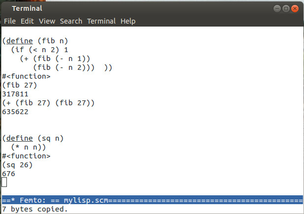

# Shell

Nia, a Greek young woman, has an account on a well known social
network. She visits her friends’ postings on a daily basis, and when
she finds an interesting picture or video, she presses the
*Like*-button. However, when she needs to discuss her upcoming
holidays on the Saba Island with her Argentinian boyfriend, she uses
the live chat box or the WhatsApp messenger. She also uses chat
services to interact with ChatGPT or Claude. After all, hitting
buttons and icons offers only a very limited interaction tool, and
does not produce a highly detailed level of information that permits
the answering of questions and making of statements.

Using a chat service needs to be very easy and fun, otherwise all
those teenage friends of Nia’s would be doing something else. I am
telling you this, because there are two ways of commanding a computer.
The first is called Graphical User Interface (GUI) and consists of
moving the cursor with a mouse or other pointing device and clicking
over a menu option or an icon, such as the *Like* button. As
previously mentioned, a Graphical User Interface often does not
generate adequate information for making a request to the computer. In
addition, finding the right object to press can become difficult in a
labyrinth of menu options.

The other method of interacting with the computer is known as Shell
and is similar to a chat with one’s own machine.

In your computer, there is a giant program, called the operating
system, which controls all peripherals that the machine uses to stay
connected with the external world: pointing devices, keyboard, video
terminal, robots, cameras, solid state drives, pen drives, and other
peripherals.

In a Shell interface, Nia issues written instructions that the
operating system answers by fulfilling the assigned tasks. The
language that Nia uses to chat with the operating system is called
*Bourne-again shell*, or bash for short. This language has commands to
go through folders, browser files, create new directories, copy
objects from one place to the other, configure the machine, install
applications, change the permissions of a file, create groups to
organize users and devices, etc. Recent Macintosh computers use zsh, a
cousin of bash; for the commands of this chapter, the two languages
are the same. When accessing the operating system through a text-based
terminal, a shell language is the main way of executing programs and
doing work on a computer.

If you have a subscription, you can ask help from Codex or Claude CLI
to run more complex interactions than the ones discribed here.

The shell interface derives its name from the fact that it acts like a
shell surrounding all other programs being run, and controlling
everything the machine performs.

To make a long story short, it is much faster to complete tasks using
a shell than with graphical applications, icons, menus and mouse.
Another benefit of the shell is that you can gain access to many more
commands and scripts than with a Graphical User Interface. Besides,
modern AI tools made it easy to use a shell: When in trouble, just ask
Codex to do the job for you.

In order not to scare off the feeble-minded, many operating systems
hide access to the text terminal. In some distribution of Linux, you
need to maintain the `Alt` key down, then press the `F2` key to open a
dialog box, where you must type the name of the terminal you want to
open. If you are really lucky, you may find the icon of the terminal
on the toolbar.

If the way of opening the text terminal is not obvious, you should ask
for help from a student majoring in Computer Science. You can teach
her Russian, Samskrit, Javanese or Ancient Greek, as a compensation
for the time that she will spend explaining how to start a terminal in
OS X or Linux. If you are afraid of paying for a few minutes of
tutorial about the Bourne-again shell with hundred hours of classes on
Russian, don’t worry\! The CS major will give up after barely starting
the section on the alphabet. After all, Philology is much more
difficult than Computer Engineering. For details, read the tale “The
man who could speak Javanese” by Lima Barreto.

### The prompt.

The shell prompt is where one types commands. The prompt has different
aspects, depending on the configuration of the terminal. In Nia’s
machine, it looks something like this:

> `~$ _`

Files are stored in folders. Typically, the prompt shows the folder
where the user is currently working.

The main duty of the operating system is to maintain the contents of
the mass storage devices in a tree structure of files and folders.
Folders are also called *directories*, and like physical folders or
cabinets, they organize files.

A folder can be put inside another folder. In a given machine, there
is a folder reserved for duties carried out by the administrator. This
special folder is called home or personal directory.

Besides the administrator, a machine can have other rightful users,
each with a personal folder. For instance, Nia’s folder on her Mac OS
X has the `/Users/nia` path. You will learn a more formal definition
of path later on.

### pwd \#

The `pwd` command informs the user’s position in the file tree. A
folder can be placed inside another folder. For example, in a
Macintosh, Nia’s home folder is inside the `/Users` directory.

One uses a path to identify a nest of folders. In a path, a subfolder
is separated from the parent folder by a slash bar. If one needs to
know the current folder, there is the `pwd` command.

> ` ~$ pwd         # shows the current folder.  ``Enter`  
> `/Users/nia`  

When Nia issues a command, she may add comments to it, so her
boyfriend that does not know Bourne-again shell (bash) can understand
what is going on and learn something in the process. Comments are
prefixed with the `#` hash char, as you can see in the above chat.
Therefore, when the computer sees a `#` hash char, it ignores
everything to the end of the line.

### mkdir wrk \#

creates a `wrk` folder inside the current directory, where `wrk` can
be replaced with any other name. For instance, if Nia is inside her
home directory, `mkdir wrk` creates a folder with the `/Users/nia/wrk`
path.

### cd wrk \#

One can use the `cd <folder name>` commands to enter the named folder.
The `cd ..` command takes Nia to the parent of the current directory.
Thanks to the `cd` command, one can navigate through the tree of
folders and directories.

### Tab.

If you want to go to a given directory, type part of the directory
path, and then press `Tab`. The shell will complete the folder name
for you.

### Home directory.

One can use a `~` tilde to represent the home directory. For instance,
`cd ~` will send Nia to her personal folder. The `cd $HOME` has the
same effect, i.e., it places Nia inside her personal directory.

### echo \#

One can use the `echo` command to print something. Therefore, `echo
$HOME` prints the contents of the `HOME` environment variable on the
terminal.

Environment variables store the terminal configuration. For instance,
the `HOME` variable contains the user’s personal directory identifier.
One needs to prefix the environment variable with the `$` char to
access its contents. Therefore, `echo $HOME` displays the contents of
the `HOME` variable.

The instruction `echo "Work Space" > readme.txt` creates a
`readme.txt` text file and writes the `"Work Space"` string there. If
the `readme.txt` file exists, this command supersedes it.

The command `echo "Shell practice" >> readme.txt` appends a string to
a text file. It does not erase the previous content of the
`readme.txt` file. Of course, you should replace the string or the
file name, as necessity dictates.

Below you will find an extended example of a chat between Nia and the
OS X operating system.

> ` ~$ mkdir wrk   # creates a work space folder       ` `Enter`  
> ` ~$ cd wrk      # transfers action to the wrk file  ` `Enter`  
> ` ~/wrk$ echo "* Work space" > readme.txt  ` `Enter`  
> ` ~/wrk$ echo "This folder is used" >> readme.txt  ``Enter`  
> ` ~/wrk$ echo "to practice the bash" >> readme.txt  ` `Enter`  
> ` ~/wrk$ echo "commands and queries." >> readme.txt  ` `Enter`  
> ` ~/wrk$ ls      # list files in current folder.  ` `Enter`  
> ` readme.txt  `  
> `~/wrk$ cat readme.txt  # shows the file contents.` `Enter`
> 
>     * Work space
>     This folder is used
>     to practice the bash
>     commands and queries.

### ls \#

By convention, a file name has two parts, the id and the extension.
The id is separated from the extension by a dot. The ` ls ` command
lists all files and subfolders present in the current folder. The `ls
*.txt` prints only files with the `.txt` extension.

### Wild card.

The `*.txt` pattern is called wild card. In a wild card, the `*`
asterix matches any sequence of chars, while the `?` interrogation
mark matches a single char.

### ls -lia \*.txt \#

prints detailed information about the `.txt` files, like date of
creation, size, etc.

> ` ~/wrk$ ls -la  ` `Enter`

    total 8
    drwxr-xr-x    3 edu500ac  staff    102 Sep 18 16:29 .
    drwxr-xr-x+ 321 edu500ac  staff  10914 Sep 18 14:40 ..
    -rw-r--r--    1 edu500ac  staff     74 Sep 18 16:30 readme.txt

Files starting with a dot are called hidden files, due to the fact
that the `ls` command does not normally show them. All the same, the
`ls -a` option includes the hidden files in the listing.

In the preceding examples, the first character in each list entry is
either a dash (-) or the letter d. A dash (-) indicates that the file
is a regular file. The letter d indicates that the entry is a folder.
A special file type that might appear in a `ls -la` command is the
symlink. It begins with a lowercase l, and points to another location
in the file system. Directly after the file classification comes the
permissions, represented by the following letters:

  - r – read permission.

  - w – write permission.

  - x – execute permission.

### cp readme.txt lire.txt \#

makes a copy of a file. You can copy a whole directory with the `-rf`
options, as shown below.

> 
> 
>     ~/wrk$ ls
>     readme.txt
>     ~/wrk$ cp readme.txt lire.fr
>     ~/wrk$ ls
>     lire.fr  readme.txt
>     ~/wrk$ cd ..
>     ~$ cp -rf wrk wsp
>     ~$ cd wsp/
>     ~/wsp$ ls
>     lire.fr  readme.txt

### rm lire.txt \#

removes a file. The `-rf` option removes a whole folder.

> 
> 
>     ~/wsp$ ls
>     lire.fr  readme.txt
>     ~/wsp$ rm lire.fr
>     ~/wsp$ ls
>     readme.txt
>     ~/wsp$ cd ..
>     ~$ ls wrk
>     lire.fr  readme.txt
>     ~$ rm -rf wrk
>     ~$ ls wrk
>     ls: wrk: No such file or directory

### mv wsp wrp \#

changes the name of a file or folder, or even permits the moving of a
file or folder to another location.

> 
> 
>     ~$ mv wsp wrk
>     ~$ cd wrk
>     ~/wrk$ ls
>     readme.txt
>     ~/wrk$ mv readme.txt read.me
>     ~/wrk$ ls
>     read.me
>     ~/wrk$ cp read.me wrk-readme.txt
>     ~/wrk$ ls
>     read.me  wrk-readme.txt
>     ~/wrk$ mv wrk-readme.txt ~/Documents/
>     ~/wrk$ ls
>     read.me
>     ~/wrk$ cat ~/Documents/wrk-readme.txt
>     Work space
>     This folder is used
>     to practice the bash
>     commands and queries.

### Where programs go.

Unix and Unix like systems are unable to find a command, except when
it is installed in a pre-defined search path or when the file path is
completely specified. The search path is kept in the `PATH`
environment variable:

> 
> 
>     ~$ echo $PATH
>     /opt/homebrew/bin:/usr/local/bin:/usr/bin:/bin
>     ~$ which sbemacs
>     /usr/local/bin/sbemacs

The `which` command tells where a program is. If you installed two
copies of a program, the shell runs the one whose folder comes first
in `PATH`.

# ABOUT

The present text is based on *An introduction to femtolisp*,
by Eduardo Costa and Vernon Sipple.

Browsered was written by Eduardo Costa, on top of FemtoEmacs by Hugh Barney
and Lucas Guerra.
